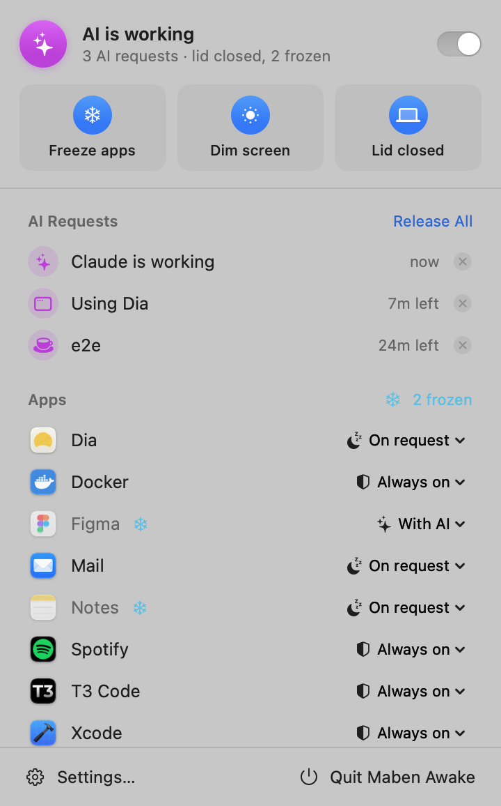
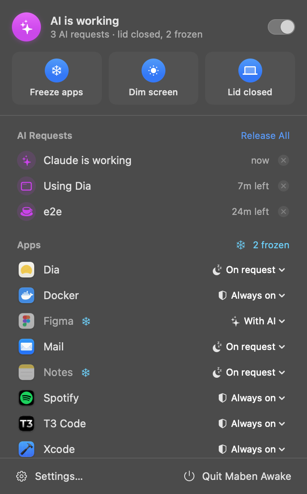

# Maben Awake

A tiny macOS menu bar app: keep the Mac awake for the apps your AI agent needs
(T3 Code, Dia, Docker…) and freeze everything else so it uses no CPU.

Part of [Maben](https://maben.gg). Product colour: Awake violet `#9F7BFF` with a
black mark. Website: `awake-site/` in the Maben folder (awake.maben.gg).

The app was called Sleepwalker before it joined Maben, and that name stays as
the internal codename: the bundle ID (`com.maxbenschop.sleepwalker`), the
executable, the launchd labels and the settings, lease and log paths are
unchanged, so an existing install keeps its data. `./build.sh install` replaces
`/Applications/Sleepwalker.app` and moves the hooks and launch agent over.

<p>
  
  
</p>

## Build & install

```sh
./build.sh install    # builds, copies to /Applications, launches
```

Needs Xcode command line tools (`xcode-select --install`). macOS 13+.

## Release

`./release.sh` builds `dist/Maben-Awake-<version>.dmg` (drag to Applications) and `.zip` for the public download: universal (Apple silicon and
Intel), hardened runtime, signed with the Developer ID of team NJTYRVLSA8 and notarized and stapled by Apple.
It runs the installer test first, generates a throwaway Xcode project from `project.yml` (needs
[xcodegen](https://github.com/yonaskolb/XcodeGen)) and signs and notarizes through the Apple account in Xcode,
so nothing else needs setting up. Takes a few minutes, mostly waiting for Apple.

For a new version: bump `CFBundleShortVersionString` in `Info.plist`, run `./release.sh`, copy the .dmg and
.zip to `awake-site/download/` in the Maben folder, set the version, dates and file names in
`awake-site-src/release.json`, add a changelog entry, run `python3 awake-site-src/build.py --hash` there (fills in
sizes and checksums and rebuilds every page that shows them), and deploy the site.

A downloaded copy sets itself up: on first start from Applications it opens Settings → AI, where the Claude
Code hooks and the `awake` command are installed, updated or removed with a button (`Integration.swift`,
tested by `tests/integration-test.sh` against a temporary home folder). Opened straight from Downloads it asks
to be moved to Applications first (`FirstRun.swift`).

## How it works

- **Keep Mac awake** – holds a `PreventUserIdleSystemSleep` power assertion.
  The display still turns off; only the system stays up.
- **Only while a checked app is running** – the assertion is released as soon
  as none of your checked apps are running, so the Mac sleeps normally again.
- **Freeze unneeded apps while lid is closed** – only with the lid closed,
  apps that no AI needs are sent `SIGSTOP` (with their helper processes). They
  use zero CPU. Opening the lid thaws everything. Apps that are still starting
  up (first 15 s) are never frozen. Everything is also resumed when you quit
  Maben Awake, and a fresh start thaws anything a crashed instance left frozen.
- **Screen brightness to 0 while lid is closed** – the previous brightness is
  saved and restored when the lid opens (or at next launch if the app died).
- **Screen stays unlocked while lid is closed** – with the lid closed the
  built-in display would idle-sleep after your *Turn display off* time, and a
  few minutes later macOS locks the screen, after which an AI can't click in
  any app. Maben Awake holds a display-sleep assertion while it keeps the Mac
  awake with the lid closed (never with the lid open), so the screen stays on
  (at brightness 0) and unlocked. Off switch in Settings → Lid & Power.
- Per-app modes – your choices are remembered per app (by bundle ID).
- **Launch at login** – in Settings; enabled automatically on first run.

## Menu and Settings

The menu shows what's keeping the Mac awake, a switch to keep it awake by
hand, quick toggles (freeze apps, dim screen, lid closed), active AI requests
with live countdowns, and every running app with its mode.

**Settings…** (⌘,) has these tabs:

| Tab | What's there |
|---|---|
| General | manual keep-awake, "only while an Always on app runs", open at login |
| Apps | modes for running *and* remembered apps, search, reset per app or all |
| Lid & Power | lid-closed mode (or its one-time setup), battery cutoff, freezing, dimming, keeping the screen unlocked |
| AI | install, update or remove the Claude Code hooks and the `awake` CLI; active requests, copyable commands, logs |
| About | version |

## Let AI ask for it (`awake` CLI)

`./build.sh install` links an `awake` command and adds Claude Code hooks to
`~/.claude/settings.json`, so **Claude Code and T3 Code keep the Mac awake
automatically while they work and let it sleep again when they stop**:

| Hook | What it does |
|---|---|
| `UserPromptSubmit`, `PreToolUse`, `PostToolUse` | hold a lease named `claude-<session>`: 15 minutes, or 2 hours while a tool runs (refreshed on every prompt and tool call) |
| `Stop`, `SessionEnd` | release the lease |

Leases show up in the menu as *AI requests* with a countdown and an ✕ to
release them by hand. Any script can use the same mechanism:

```sh
awake hold build 30            # keep awake for 30 min
awake release build
awake run tests -- npm test    # keep awake while a command runs
awake list
awake log                      # why the Mac was kept awake (or wasn't), sleeps and wakes
awake sleeplog                 # macOS's own record of real sleeps and wakes
```

Leases are just files in `~/Library/Application Support/Sleepwalker/leases/`,
so a lease can never outlive its expiry even if the tool crashes.

## Safety

- **Crash safety** – runs as a launchd agent (`~/Library/LaunchAgents/com.maxbenschop.sleepwalker.agent.plist`,
  KeepAlive on crash). If it crashes or is force-killed, launchd restarts it
  within seconds and the new instance thaws every frozen app and restores
  the sleep and brightness settings. Quit from the menu stays quit.
- **Lid-open failsafe** – a small root launch daemon
  (`/Library/LaunchDaemons/com.maxbenschop.sleepwalker.failsafe.plist`) makes
  sure opening the lid always brings the Mac back, even if Maben Awake itself
  is stuck. Maben Awake writes its view of the lid to
  `~/Library/Application Support/Sleepwalker/heartbeat.json` whenever it
  changes. If the lid opens and Maben Awake hasn't reported "lid open, screen
  restored" within 6 seconds, the daemon unfreezes every stopped process of
  the logged-in user and turns the brightness back up; if Maben Awake still
  hasn't reported in after 16 seconds, it restarts it. Being root, nothing in
  your login session can freeze it. Installed with the lid-closed setup, or
  later from Settings → Lid & Power → Safety (Maben Awake offers it once when
  it's missing or outdated). Log: `/Library/Logs/Sleepwalker-failsafe.log`
  (recoveries also appear in `awake log`). Check it with
  `/Library/PrivilegedHelperTools/com.maxbenschop.sleepwalker.failsafe status`;
  remove with `sudo Resources/install-failsafe.sh --uninstall`.
- **Only real processes are signalled** – every freeze/thaw goes through
  `Signals.send`, which refuses pid ≤ 1 and Maben Awake itself. (`kill(-1, …)`
  signals *every* process; an app that is quitting reports pid -1, which once
  froze the whole login session with the screen at brightness 0.)
- **External display** – "away" means lid closed *and* no external display.
  In clamshell mode (lid closed, external monitor) nothing is frozen or dimmed.
- **Heat check** – if macOS reports a *serious* or *critical* thermal state
  while you're away, Maben Awake stops keeping the Mac awake so it sleeps and
  cools down (logged in `~/Library/Logs/Sleepwalker.log`). Cleared when you
  open the lid.
- **Other sleep tools** – apps like Vorssaint or Amphetamine also toggle
  `pmset disablesleep`. Maben Awake reads the real value every 3 seconds, not
  just what it last set, and blocks closed-lid sleep again if another app turned
  it back on (logged as "re-enabled by another app").
- **Event log** – `~/Library/Logs/Sleepwalker.log` (or `awake log`) records
  every decision: when and why the Mac is kept awake (which Always on app,
  which AI requests), lid and power changes, whether closed-lid sleep is
  blocked and why not, and a snapshot of the state at every sleep and wake.
  Compare with `awake sleeplog` to explain an unexpected sleep.
- **Never frozen by default** – terminals and editors (where agents run),
  AI apps, calls (Zoom, FaceTime, Teams, Discord, Meet), audio (Music,
  Spotify), password managers, VPNs, sync/backup, Docker/OrbStack/Ollama/LM
  Studio, Messages, Mail. Marked with a shield in the menu; you can still
  change their mode. Apps an AI is running inside are never frozen either.

## Per-app modes

| Mode | Behaviour |
|---|---|
| **Always on** | never frozen |
| **While AI works** | awake while any Claude turn (or `awake run`) is active |
| **When AI asks** (default) | frozen until an AI requests it with `awake need <app>`; frozen again when that AI's turn ends |

Apps running from outside `/Applications` (an Xcode or `swift build`
product, a test build in `/tmp`) are treated as apps under development: with
the default mode they stay awake while an AI works, so an AI testing its own
build doesn't need `awake need`. Once no AI is working they freeze like any
other app, even if the test window was left open.

When an AI is done with an app **while the lid is closed**, Maben Awake
cleans up after it: an app that wasn't running when the AI asked for it is
quit again, and in an app that was already open (Chromium browsers like Dia,
Chrome, Arc, Brave, Edge, Vivaldi) only the tabs the AI opened are closed.
If the lid was opened while the AI used the app, nothing is closed, since
you may have opened those tabs yourself.

The Claude Code hooks call `Maben Awake.app/Contents/MacOS/sleepwalker-hook`,
a small compiled program (~8 ms per call; the old shell hook took ~50–60 ms).
`awake hook` forwards to it. It prints nothing, so it costs Claude no tokens.

Hooks request apps automatically for browser tools (→ default browser),
`docker`/`kubectl` commands, `osascript 'tell application "X"'`,
`open -a X` and [agent-desktop](https://github.com/vercel-labs/agent-desktop)
(`--app X`, `launch X`, `close-app X`). Frozen apps are frozen together with their helper processes
(browser tabs, Electron helpers). Hook activity is logged to
`~/Library/Logs/Sleepwalker-hooks.log`.

## Testing

`tests/deep-test.sh` runs a ~2 minute end-to-end test (auto-freeze, helper
processes, CPU while frozen, wake on request, expiry, owner crash, two
requesters, closed-lid power state) and writes a report to the Desktop. `tests/lid-test.sh` checks the real
lid close/open cycle, `tests/cleanup-test.sh` the tab/app cleanup (run it while no other AI
session is using the browser, or its tab checks are correctly skipped),
`tests/hook-equivalence-test.py` compares the compiled hook with the shell
version, `tests/failsafe-test.sh` runs the failsafe daemon's lid-open logic with
a fake lid and a dry run (safe while Maben Awake runs), and `tests/live-session-test.sh` runs a real headless Claude session.
Dia note: reading page content via AppleScript JavaScript needs Dia launched
with `--enable-applescript-javascript`; the test reads the tab title/URL from
Dia and fetches the text over HTTP instead.

UI snapshots: `swift build && .build/debug/Sleepwalker --snapshot /tmp/snaps`
renders the menu and every Settings tab (light and dark) to PNGs with canned
data. It never starts the real app, so it's safe while Maben Awake is running.

## Notes

- Frozen apps can't receive network messages or notifications while frozen.
  Don't freeze things like Messages if you want notifications.
- **Lid closed** – macOS ignores normal keep-awake requests when the lid
  closes, so Maben Awake uses `pmset disablesleep`. Click the *Lid closed…*
  tile in the menu (or *Set Up…* in Settings → Lid & Power) once; it asks for
  your password and installs
  `/etc/sudoers.d/awakekeeper`, which allows only
  `pmset -a disablesleep 0|1` without a password. Closed-lid sleep is blocked
  only while Maben Awake is keeping the Mac awake, below 20% battery (adjustable
  in Settings) it's re-enabled, and quitting the app always re-enables it. Remove with
  `sudo Resources/install-lid-helper.sh --uninstall`.
- Docker Desktop's actual engine runs in helper processes, not the main app,
  and Maben Awake only touches regular (Dock-visible) apps, so checking Docker
  is enough.

## Licence

MIT, see `LICENSE`. Download the signed app at [awake.maben.gg](https://awake.maben.gg).
