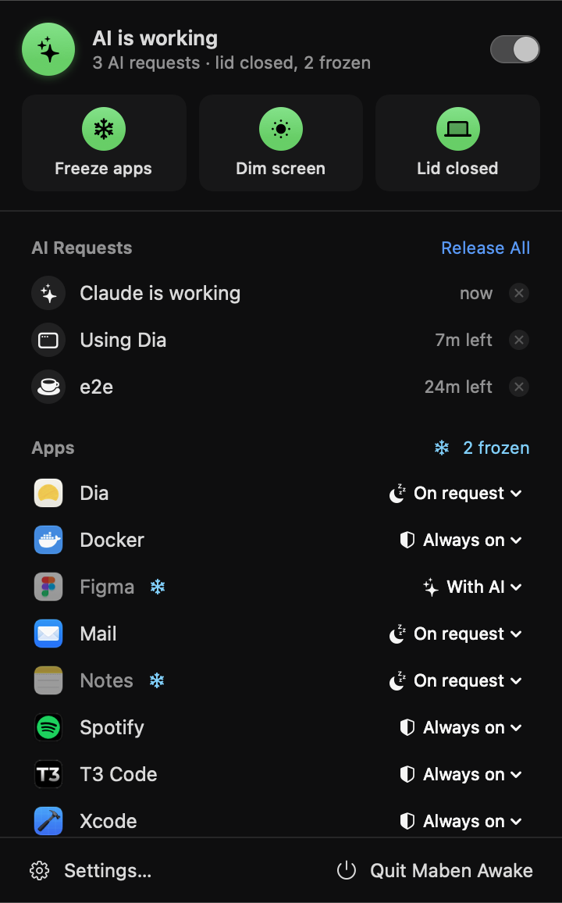
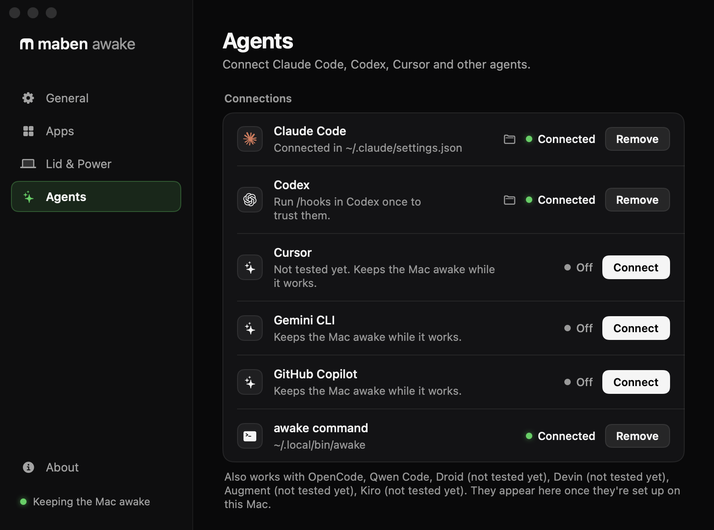

# Maben Awake

A tiny macOS menu bar app: keep the Mac awake for the apps your AI agent needs
(T3 Code, Dia, Docker…) and freeze everything else so it uses no CPU.

Part of [Maben](https://maben.gg). Product colour: Awake green `#30D158` with a
black mark. Website: `awake-site/` in the Maben folder (awake.maben.gg).

The app was called Sleepwalker until 1.5. Since then everything carries the
Maben Awake name: the executable (`MabenAwake`), the hook (`maben-awake-hook`),
the launchd labels (`gg.maben.awake.agent`, `gg.maben.awake.failsafe`) and the
lease and log paths. An install of 1.4 or earlier is moved over when 1.5 first
starts (`Sources/MabenAwake/Legacy.swift`, the only code that still knows the
old name):

- requests and logs move to the new paths, and the launch agent is replaced by
  one with the new label;
- every connected agent is pointed at the hook's new name;
- the root failsafe and the sudoers rule are renamed the next time the
  failsafe is installed, which Maben Awake offers once (it needs a password).

Two links in the app, `Contents/MacOS/Sleepwalker` and `sleepwalker-hook`, keep
the update itself working: the launch agent of 1.4 starts the app by its old
name one last time, and agent sessions that were open during the update still
call the old hook. They can go once nobody runs 1.4 any more.

The bundle ID is still `com.maxbenschop.sleepwalker`. 1.4 only installs an
update signed with its own ID, so changing it now would cut those copies off
from updates. 1.5 accepts `gg.maben.awake` as well and copies the settings
over, so a later release can switch by changing the ID in `Info.plist` and
`project.yml`.

<p>
  
  
</p>

## Build & install

```sh
./build.sh install    # builds, copies to /Applications, launches
```

Needs Xcode command line tools (`xcode-select --install`). macOS 13+.

## Updates

The app updates itself from GitHub Releases (`Sources/MabenAwake/Updater.swift`):

1. At start, every 6 hours, and after waking (if it has been 6 hours) it asks the GitHub API for the latest release (never drafts or pre-releases).
2. If its tag `vX.Y.Z` is newer, the menu bar icon turns green and the menu and Settings › General show an
   Update button. With "Install updates automatically" on (default), it installs by itself once the lid is
   open and no agent is working.
3. It downloads `Maben-Awake.zip` from that release, and only installs it if the app inside is signed with
   the Developer ID of team NJTYRVLSA8 with this bundle ID, accepted by Gatekeeper (notarized), and has the
   announced version. The old app goes to the Trash.
4. It wakes every frozen app, restores sleep and brightness, and restarts as the new version.

The website's download buttons go to `/download/latest.dmg`, which the web server redirects to
`releases/latest/download/Maben-Awake.dmg` on GitHub, so they always serve the newest release.

See `CONTRIBUTING.md` for branches, pull requests and the rules on `main`.

## Release

`./release.sh` builds `dist/Maben-Awake.dmg` (drag to Applications) and `dist/Maben-Awake.zip` (used by the updater): universal (Apple silicon and
Intel), hardened runtime, signed with the Developer ID of team NJTYRVLSA8 and notarized and stapled by Apple.
It runs the installer test first, generates a throwaway Xcode project from `project.yml` (needs
[xcodegen](https://github.com/yonaskolb/XcodeGen)) and signs and notarizes through the Apple account in Xcode,
so nothing else needs setting up. Takes a few minutes, mostly waiting for Apple.

For a new version: bump `CFBundleShortVersionString` in `Info.plist`, add a `## <version> · <date>` section to
`CHANGELOG.md`, merge to `main`, run `./release.sh`, then `./publish.sh`. That tags the commit, creates the GitHub
release (notes from `CHANGELOG.md`), and rebuilds and deploys awake.maben.gg (version, checksums, changelog page).

A downloaded copy sets itself up: on first start from Applications it opens Settings → Agents, where the hooks
of Claude Code and the other agents and the `awake` command are installed, updated or removed with a button
(`Integration.swift`, tested by `tests/integration-test.sh` against a temporary home folder). Opened straight from Downloads it asks
to be moved to Applications first (`FirstRun.swift`).

## How it works

- **Keep Mac awake** – holds a `PreventUserIdleSystemSleep` power assertion.
  The display still turns off; only the system stays up.
- **Only while a checked app is running** – the assertion is released as soon
  as none of your checked apps are running, so the Mac sleeps normally again.
- **Freeze unneeded apps while lid is closed** – only with the lid closed,
  apps that no AI needs are sent `SIGSTOP` (with their helper processes). They
  use zero CPU. Opening the lid thaws everything. Apps that are still starting
  up (first 15 s) are never frozen. Everything is also resumed when you quit
  Maben Awake, and a fresh start thaws anything a crashed instance left frozen.
- **Screen brightness to 0 while lid is closed** – the previous brightness is
  saved and restored when the lid opens (or at next launch if the app died).
- **Screen stays unlocked while lid is closed** – with the lid closed the
  built-in display would idle-sleep after your *Turn display off* time, and a
  few minutes later macOS locks the screen, after which an AI can't click in
  any app. Maben Awake holds a display-sleep assertion while it keeps the Mac
  awake with the lid closed (never with the lid open), so the screen stays on
  (at brightness 0) and unlocked. Off switch in Settings → Lid & Power.
- Per-app modes – your choices are remembered per app (by bundle ID).
- **Launch at login** – in Settings; enabled automatically on first run.

## Menu and Settings

The menu shows what's keeping the Mac awake, a switch to keep it awake by
hand, quick toggles (freeze apps, dim screen, lid closed), active AI requests
with live countdowns, and every running app with its mode.

**Settings…** (⌘,) has these tabs:

| Tab | What's there |
|---|---|
| General | manual keep-awake, "only while an Always on app runs", open at login |
| Apps | modes for running *and* remembered apps, search, reset per app or all |
| Lid & Power | lid-closed mode (or its one-time setup), battery cutoff, freezing, dimming, keeping the screen unlocked |
| Agents | connect, update or remove Claude Code, the other agents set up on this Mac, and the `awake` CLI; active requests, copyable commands, logs |
| About | version |

## Other agents

Every agent uses the same hook program, called with `--agent <id>` (and
`--event <name>`, since not every agent says in its JSON which event it is).
Settings → Agents lists the agents set up on this Mac (their config folder
exists) with a Connect button each. Their requests show as *Cursor is
working*, *Gemini CLI is working* and so on in the menu.

| Agent | Where the hooks go | Notes |
|---|---|---|
| Codex | `~/.codex/hooks.json` | run `/hooks` in Codex once to trust them; also set by `./build.sh install` |
| Cursor (editor and CLI) | `~/.cursor/hooks.json` | not tested yet. No `preToolUse`: Cursor blocks a tool call whose hook answers anything but a valid decision, so the hold is 2 hours from the prompt on, and apps a command names are woken once it has finished |
| Gemini CLI | `~/.gemini/settings.json` | end of turn is `AfterAgent` |
| GitHub Copilot (CLI and VS Code) | `~/.copilot/hooks/maben-awake.json` | our own file; needs Copilot CLI 1.0.6 or later |
| OpenCode | `~/.config/opencode/plugins/maben-awake.js` | a plugin, since OpenCode has no hooks; it passes each event to the hook |
| Qwen Code | `~/.qwen/settings.json` | |
| Droid | `~/.factory/hooks.json`, or `settings.json` when that already has hooks | not tested yet. Droid ignores the hooks in its settings once `hooks.json` exists |
| Devin (was Windsurf) | `~/.config/devin/config.json` | not tested yet |
| Augment | `~/.augment/settings.json` | not tested yet |
| Kiro | `~/.kiro/hooks/maben-awake.json` | not tested yet. Our own file; Kiro CLI 3 or later |

Files shared with the agent keep everything else in them, and get one backup
(`<file>.before-maben-awake`) the first time. A settings file that isn't plain
JSON (comments) is left alone and reported. Cursor and Devin also run the
hooks in Claude Code's settings; the hook recognises them, so connecting both
doesn't count a session twice.

`tests/agent-hooks-test.py` feeds the hook what each agent sends, as its
documentation describes it. Claude Code, Codex (0.156), GitHub Copilot CLI
(1.0.108), OpenCode (1.19.5), Gemini CLI (0.67) and Qwen Code were also run for
real: a prompt, a shell command and the end of the turn each reached the hook
and left the right requests. Cursor, Droid, Devin, Augment and Kiro need an
account and are built from their documentation only (`tested: false` in
`Integration.agents`); Settings shows them as "Not tested yet", and none of
their hooks can block or approve anything, so the worst case is that the Mac
isn't kept awake.

Codex ties its approval of a hook to the command. The hook's path changed in
1.5, so Codex asks to review the hooks again: run `/hooks` once.

Not connected: Amp, Pi and Cline (plugins that have to answer for every tool
call), Goose and Crush, and Aider and Zed (no hooks at all). They can still
use the `awake` command, for example `awake run aider -- aider`.

To add an agent: one entry in `Integration.agents`, its event and tool names
in `Sources/MabenAwakeHook/main.swift` if they are new, a name in `is_agent`
in `Resources/awake`, and its payloads in `tests/agent-hooks-test.py`.

## Let AI ask for it (`awake` CLI)

`./build.sh install` links an `awake` command and adds Claude Code hooks to
`~/.claude/settings.json`, so **Claude Code and T3 Code keep the Mac awake
automatically while they work and let it sleep again when they stop** (the
other agents do the same through their own events, see above):

| Hook | What it does |
|---|---|
| `UserPromptSubmit`, `PreToolUse`, `PostToolUse` | hold a lease named `<agent>-<session>` (`claude-3f2a…`): 15 minutes, or 2 hours while a tool runs (refreshed on every prompt and tool call) |
| `Stop`, `SessionEnd` | release the lease; at `Stop`, background work Claude Code says is still running keeps a lease `<agent>-<session>-bg` until a later turn ends with none (at most 8 hours after the last turn) |
| `PostToolUseFailure` | if apps are frozen and the failure looks like a frozen app (a timed-out Apple event, a hang), tell Claude Code in one line; an app the error names is woken |

The hook wakes an app when a tool call is about to use it, so agents don't have
to ask. `tell application "X"`, `open -a X`, `agent-desktop --app X` and
`docker` wake it whether or not it is frozen (as before 1.6). Maben Awake also
writes the apps it has frozen to `~/Library/Application Support/MabenAwake/frozen`,
and these wake only an app on that list: System Events' `tell process "X"`,
JavaScript for Automation's `Application("X")`, `quit app "X"`, `open -b` /
`tell application id`, `open X.app`, `pkill` / `killall X`, `open <link>` for
the default browser, and the name or bundle ID where a command addresses an
app. Background commands and anything detached with `nohup` or `&` keep the
Mac awake as well, without counting as an AI at work, so `awake run` is only
needed for scripts and agents without hooks.

Leases show up in the menu as *AI requests* with a countdown and an ✕ to
release them by hand. Any script can use the same mechanism:

```sh
awake hold build 30            # keep awake for 30 min
awake release build
awake run tests -- npm test    # keep awake while a command runs
awake list
awake log                      # why the Mac was kept awake (or wasn't), sleeps and wakes
awake sleeplog                 # macOS's own record of real sleeps and wakes
```

Leases are just files in `~/Library/Application Support/MabenAwake/leases/`,
so a lease can never outlive its expiry even if the tool crashes.

## Safety

- **Crash safety** – runs as a launchd agent (`~/Library/LaunchAgents/gg.maben.awake.agent.plist`,
  KeepAlive on crash). If it crashes or is force-killed, launchd restarts it
  within seconds and the new instance thaws every frozen app and restores
  the sleep and brightness settings. Quit from the menu stays quit.
- **Lid-open failsafe** – a small root launch daemon
  (`/Library/LaunchDaemons/gg.maben.awake.failsafe.plist`) makes
  sure opening the lid always brings the Mac back, even if Maben Awake itself
  is stuck. Maben Awake writes its view of the lid to
  `~/Library/Application Support/MabenAwake/heartbeat.json` whenever it
  changes. If the lid opens and Maben Awake hasn't reported "lid open, screen
  restored" within 6 seconds, the daemon unfreezes every stopped process of
  the logged-in user and turns the brightness back up; if Maben Awake still
  hasn't reported in after 16 seconds, it restarts it. Being root, nothing in
  your login session can freeze it. Installed with the lid-closed setup, or
  later from Settings → Lid & Power → Safety (Maben Awake offers it once when
  it's missing or outdated). Log: `/Library/Logs/MabenAwake-failsafe.log`
  (recoveries also appear in `awake log`). Check it with
  `/Library/PrivilegedHelperTools/gg.maben.awake.failsafe status`;
  remove with `sudo Resources/install-failsafe.sh --uninstall`.
- **Only real processes are signalled** – every freeze/thaw goes through
  `Signals.send`, which refuses pid ≤ 1 and Maben Awake itself. (`kill(-1, …)`
  signals *every* process; an app that is quitting reports pid -1, which once
  froze the whole login session with the screen at brightness 0.)
- **External display** – "away" means lid closed *and* no external display.
  In clamshell mode (lid closed, external monitor) nothing is frozen or dimmed.
- **Heat check** – if macOS reports a *serious* or *critical* thermal state
  while you're away, Maben Awake stops keeping the Mac awake so it sleeps and
  cools down (logged in `~/Library/Logs/MabenAwake.log`). Cleared when you
  open the lid.
- **Other sleep tools** – apps like Vorssaint or Amphetamine also toggle
  `pmset disablesleep`. Maben Awake reads the real value every 3 seconds, not
  just what it last set, and blocks closed-lid sleep again if another app turned
  it back on (logged as "re-enabled by another app").
- **Event log** – `~/Library/Logs/MabenAwake.log` (or `awake log`) records
  every decision: when and why the Mac is kept awake (which Always on app,
  which AI requests), lid and power changes, whether closed-lid sleep is
  blocked and why not, and a snapshot of the state at every sleep and wake.
  Compare with `awake sleeplog` to explain an unexpected sleep.
- **Never frozen by default** – terminals and editors (where agents run),
  AI apps, calls (Zoom, FaceTime, Teams, Discord, Meet), audio (Music,
  Spotify), password managers, VPNs, sync/backup, Docker/OrbStack/Ollama/LM
  Studio, Messages, Mail. Marked with a shield in the menu; you can still
  change their mode. Apps an AI is running inside are never frozen either.

## Per-app modes

| Mode | Behaviour |
|---|---|
| **Always on** | never frozen |
| **While AI works** | awake while any agent's turn (or `awake run`) is active |
| **When AI asks** (default) | frozen until an AI uses it: a command that names it wakes it, or `awake need <app>`; frozen again when that AI's turn ends |

Apps running from outside `/Applications` (an Xcode or `swift build`
product, a test build in `/tmp`) are treated as apps under development: with
the default mode they stay awake while an AI works, so an AI testing its own
build doesn't need `awake need`. Once no AI is working they freeze like any
other app, even if the test window was left open.

When an AI is done with an app **while the lid is closed**, Maben Awake
cleans up after it: an app that wasn't running when the AI asked for it is
quit again, and in an app that was already open (Chromium browsers like Dia,
Chrome, Arc, Brave, Edge, Vivaldi) only the tabs the AI opened are closed.
If the lid was opened while the AI used the app, nothing is closed, since
you may have opened those tabs yourself.

The hooks call `Maben Awake.app/Contents/MacOS/maben-awake-hook`,
a small compiled program (~8 ms per call; the old shell hook took ~50–60 ms).
`awake hook` forwards to it. It prints nothing, so it costs the agent no tokens.

Hooks request apps automatically for browser tools (→ default browser),
`docker`/`kubectl` commands, `osascript 'tell application "X"'`,
`open -a X` and [agent-desktop](https://github.com/vercel-labs/agent-desktop)
(`--app X`, `launch X`, `close-app X`). Frozen apps are frozen together with their helper processes
(browser tabs, Electron helpers). Hook activity is logged to
`~/Library/Logs/MabenAwake-hooks.log`.

## Testing

`tests/deep-test.sh` runs a ~2 minute end-to-end test (auto-freeze, helper
processes, CPU while frozen, wake on request, expiry, owner crash, two
requesters, closed-lid power state) and writes a report to the Desktop. `tests/lid-test.sh` checks the real
lid close/open cycle, `tests/cleanup-test.sh` the tab/app cleanup (run it while no other AI
session is using the browser, or its tab checks are correctly skipped),
`tests/hook-equivalence-test.py` compares the compiled hook with the shell
version, `tests/agent-hooks-test.py` checks the hook against every agent's events, `tests/failsafe-test.sh` runs the failsafe daemon's lid-open logic with
a fake lid and a dry run (safe while Maben Awake runs), and `tests/live-session-test.sh` runs a real headless Claude session.
Dia note: reading page content via AppleScript JavaScript needs Dia launched
with `--enable-applescript-javascript`; the test reads the tab title/URL from
Dia and fetches the text over HTTP instead.

UI snapshots: `swift build && .build/debug/MabenAwake --snapshot /tmp/snaps`
renders the menu and every Settings tab (light and dark) to PNGs with canned
data and a demo set of connected agents (a scratch home folder, so nothing of
this Mac's setup shows up). It never starts the real app, so it's safe while
Maben Awake is running. The pictures in `docs/screenshots/` come from it; run
`./build.sh` once first so the About page has the app icon.

## Notes

- Frozen apps can't receive network messages or notifications while frozen.
  Don't freeze things like Messages if you want notifications.
- **Lid closed** – macOS ignores normal keep-awake requests when the lid
  closes, so Maben Awake uses `pmset disablesleep`. Click the *Lid closed…*
  tile in the menu (or *Set Up…* in Settings → Lid & Power) once; it asks for
  your password and installs
  `/etc/sudoers.d/awakekeeper`, which allows only
  `pmset -a disablesleep 0|1` without a password. Closed-lid sleep is blocked
  only while Maben Awake is keeping the Mac awake, below 20% battery (adjustable
  in Settings) it's re-enabled, and quitting the app always re-enables it. Remove with
  `sudo Resources/install-lid-helper.sh --uninstall`.
- Docker Desktop's actual engine runs in helper processes, not the main app,
  and Maben Awake only touches regular (Dock-visible) apps, so checking Docker
  is enough.

## Licence

MIT, see `LICENSE`. Download the signed app at [awake.maben.gg](https://awake.maben.gg).
